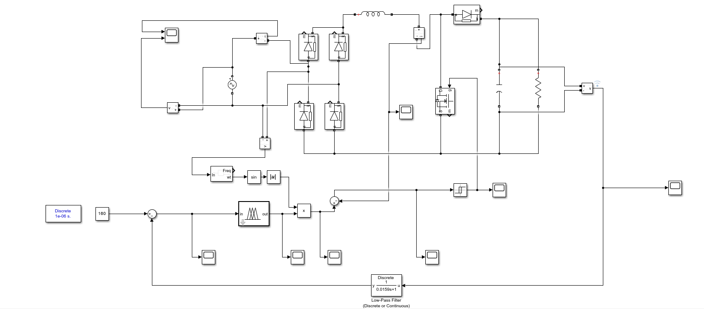
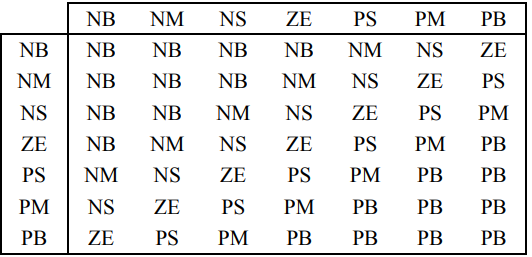
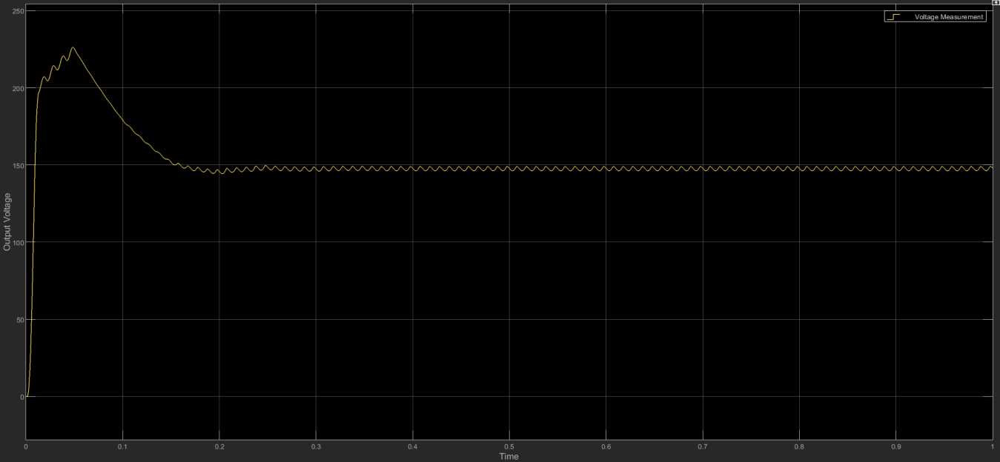
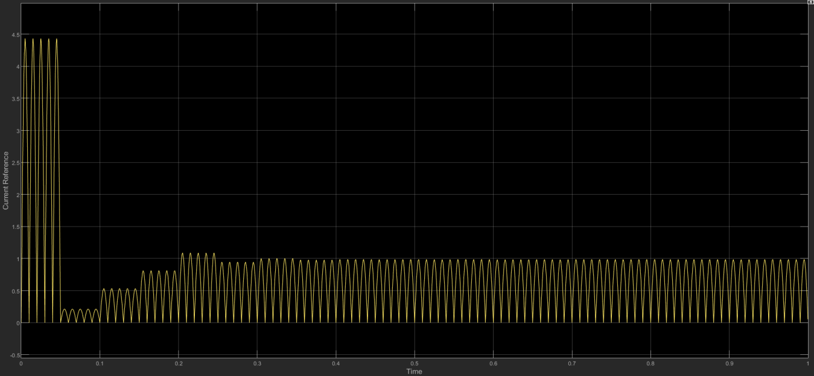
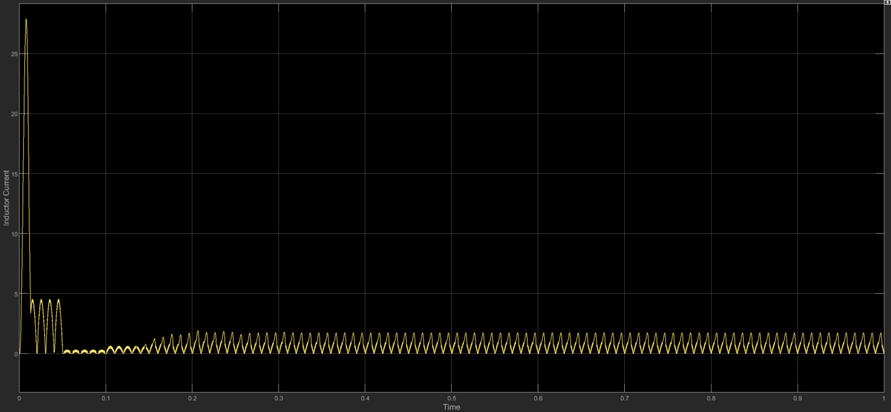
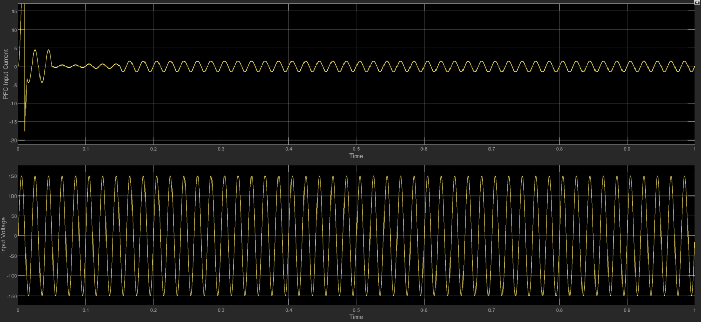
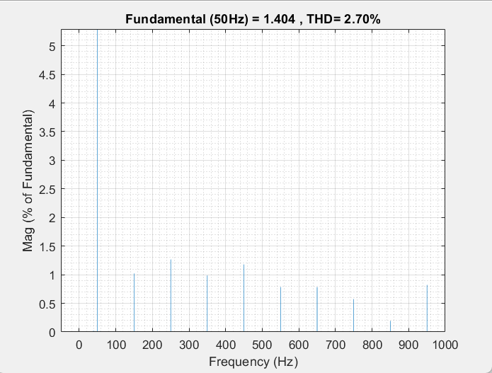
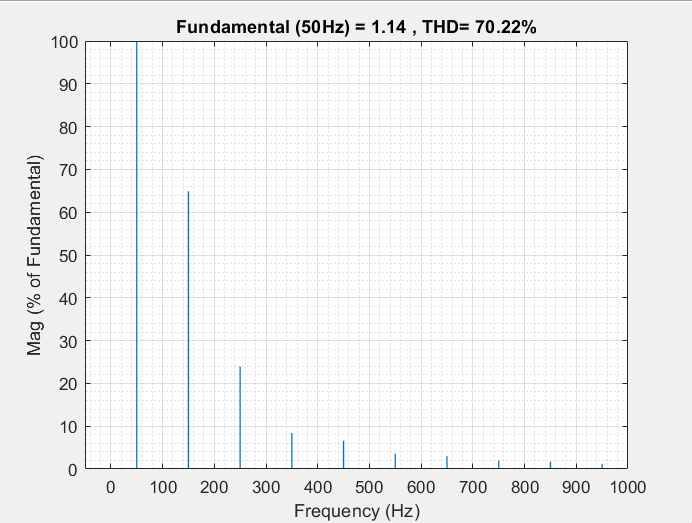
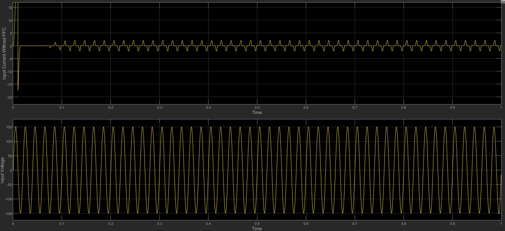

# Fuzzy Logic Controlled Boost PFC Converter

MATLAB/Simulink simulation of a single-phase boost power factor correction (PFC) converter. A fuzzy logic controller regulates the DC-link voltage, while an inner current-control loop shapes the AC input current to follow the supply voltage.

Mini project for System Simulation Lab (ELE 3142), Department of Electrical and Electronics Engineering, Manipal Institute of Technology, October 2026.

## Results at a glance

| | Input current THD |
|---|---:|
| Without PFC | **70.22%** |
| With fuzzy-controlled boost PFC | **2.70%** |

With PFC, the input current is almost sinusoidal and in phase with the input voltage. Without PFC, the capacitor draws current in short pulses near the voltage peaks, which is what drives the THD up.

The project report does not give a numerical measured power factor, so none is claimed here.

## Overview

A diode bridge rectifies the AC supply. The boost stage uses an inductor, MOSFET, diode, and output capacitor to supply the DC load. The outer voltage loop compares the DC-link voltage with a 150 V reference and feeds the error into a single-input fuzzy logic controller. Its output sets the amplitude of an inductor-current reference proportional to the rectified input voltage. The current-control stage uses inductor-current feedback to generate the MOSFET PWM signal.

```
AC source → Bridge rectifier → Boost converter → DC-link capacitor + load
                  │                  ↑
                  └→ Rectified voltage × fuzzy voltage-loop output
                                       → Current reference → Current controller + PWM
                                                               ↑
                                                    Inductor-current feedback
DC-link voltage → Compare with 150 V → Fuzzy voltage controller ────────┘
```

Key relationships used in the control loops:

```
voltage error      e_v  = V_ref - V_dc
current reference  i_L,ref(t) = K x v_rect(t)      (K set by the fuzzy controller output)
current error      e_i  = i_L,ref(t) - i_L(t)
duty ratio         D    = T_ON / T_s
```

## Simulink model



*Figure extracted from the project report.* The voltage reference block in this screenshot reads **160 V**, while the report specifications state **150 V**.

## Model parameters

| Parameter | Value |
|---|---:|
| Input voltage | 113.14 V RMS, single phase |
| Input frequency | 50 Hz |
| DC-link voltage reference | 150 V |
| Boost inductance | 22.5 mH |
| Output capacitance | 940 µF |
| Load resistance | 212 Ω |
| Switching frequency | 20 kHz |
| Simulation environment | MATLAB/Simulink |

## Fuzzy controller

A single-input fuzzy logic controller on the DC-link voltage error, as described in the project report. Its output is a control command that sets the current-reference amplitude. It is not the inductor current itself.



*Fuzzy rule base, Figure 2 of the project report.* The rule base uses seven linguistic levels: NB, NM, NS, ZE, PS, PM, PB.

## Simulation results

### DC-link voltage

The output rises during startup as the DC-link capacitor charges, then settles near the 150 V reference with ripple.



### Current reference and inductor current

The current reference is a positive full-wave waveform, proportional to the rectified input voltage. The inductor current follows the same envelope, with high-frequency switching ripple.





### AC input voltage and current, with PFC



### With PFC vs without PFC

| With PFC | Without PFC |
|:---:|:---:|
|  |  |
| **THD = 2.70%** | **THD = 70.22%** |

Input current without PFC, for reference:



Without PFC, current distortion appears at the voltage peaks, because a high current rushes through the capacitor for a short interval. With PFC, the current waveform is almost sinusoidal and in phase with the voltage.

## Running the simulation

1. Open the project's Simulink model in a MATLAB installation with its required Simulink components and Fuzzy Logic Toolbox.
2. Check the model parameters against the table above and load any accompanying fuzzy inference system (FIS) file if the model references one.
3. Run the simulation and inspect the DC-link voltage, current reference and inductor current, AC input voltage and current, and steady-state input-current FFT.
4. For a meaningful with/without PFC comparison, use the same source and load conditions and calculate THD over a steady-state interval.

## Repository contents

| File | Description |
|---|---|
| `simulinkModel.slx` | Simulink model of the converter and control loops |
| `PFC_Fuzzy_Controller_Paper_Normalized_7x7.fis` | Fuzzy inference system for the voltage controller |
| `images/` | Model screenshot and result plots shown above |
